# PROJECT: SANCTUM

<div align="center">

```
  ███████╗ █████╗ ███╗   ██╗ ██████╗████████╗██╗   ██╗███╗   ███╗
  ██╔════╝██╔══██╗████╗  ██║██╔════╝╚══██╔══╝██║   ██║████╗ ████║
  ███████╗███████║██╔██╗ ██║██║        ██║   ██║   ██║██╔████╔██║
  ╚════██║██╔══██║██║╚██╗██║██║        ██║   ██║   ██║██║╚██╔╝██║
  ███████║██║  ██║██║ ╚████║╚██████╗   ██║   ╚██████╔╝██║ ╚═╝ ██║
  ╚══════╝╚═╝  ╚═╝╚═╝  ╚═══╝ ╚═════╝   ╚═╝    ╚═════╝ ╚═╝     ╚═╝
```

**Server-Authoritative, Microscopic Dual-Resolution Action-RPG Engine**

*Small. Fast. Efficient. Moddable.*

[](https://nodejs.org/)
[](LICENSE)
[](client/)
[](shared/Constants.js)
[](server/)
[](client/systems/Interpolator.js)

</div>

---

## 📸 In-Game Screenshots

<div align="center">

### Dynamic Lighting, Torchlight & Spell FX in the Crypt Depths
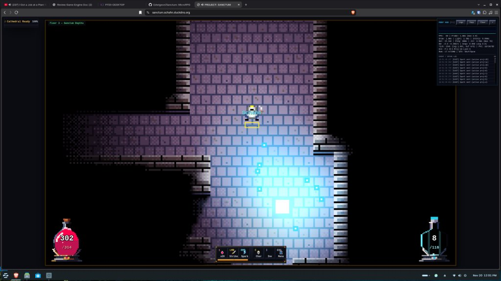

### Procedural Dungeon Exploration & Real-Time Telemetry
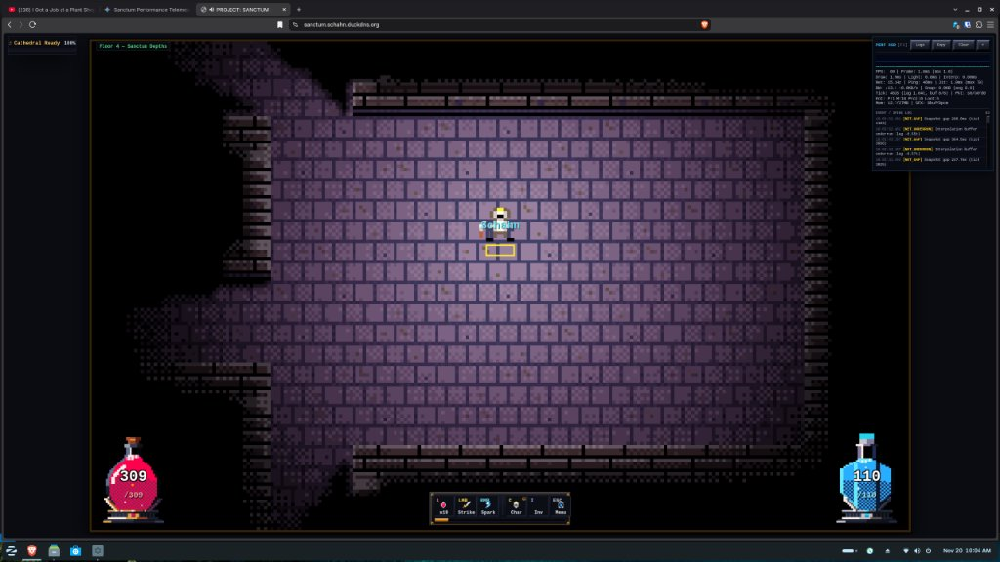

</div>

---

## ⚔️ What is Project Sanctum?

**Project Sanctum** is a microscopic, server-authoritative multiplayer retro action-RPG. Inspired by the grim dark-fantasy atmospheres of classic ARPGs and the technical elegance of fantasy consoles, Sanctum achieves high-performance cooperative dungeon-crawling with **zero client build steps**, running completely natively in modern browsers with pure ES Modules, WebSockets, HTML5 Canvas, and WebAudio.

### Core Philosophy:
* **Microscopic Footprint**: Pure standard ES modules on the client — no Webpack, no Vite, no Babel, no bundler lag. Edit code and refresh.
* **15 Hz Authoritative Simulation**: The Node.js server owns all game state, monster AI, procedural dungeon generation, collision geometry, loot drops, and combat math.
* **60+ FPS Dual-Resolution Client**: The gameplay viewport renders at an internal retro resolution of **240 × 144** with smooth subpixel entity interpolation, Bayer matrix dithering, and merged-wall analytical 2D lighting, paired with a pixel-crisp canvas HUD.
* **16-Color Canonical Palette**: Strictly adheres to the iconic PICO-8 16-color palette across all tiles, entity stamps, lighting hues, and UI elements.
* **Custom Lanthorn-PSG Synthesizer**: 100% synthesized procedural sound effects and multi-track tracker music generated in real-time with zero external audio assets.

---

## 🎨 Bit-Array Micro-Sprite System

Sanctum stores its sprites as compact **hexadecimal bit arrays** directly in code and JSON. Each character corresponds to a 16-color palette index (`0` through `f`), while `.` represents full transparency.

```javascript
// Example: Health Potion (10x10 Micro-Sprite)
potion_hp: [
  '...55.....',
  '...44.....',
  '..6776....',
  '.688886...',
  '.687886...',
  '.688886...',
  '.688886...',
  '..6886....',
  '...66.....',
  '..........'
]
```

### Extracted Sprite Showcases

#### 🛡️ Playable Hero Archetypes
Each hero class features custom bit-array animations for `idle`, `move`, `attack`, `hurt`, and `death`:
<div align="center">
  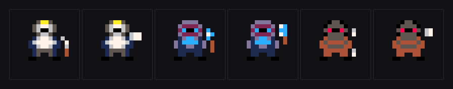
</div>

| Class | Base Role | Signature Skill | Sprite (Idle) | Sprite (Attack) |
| :--- | :--- | :--- | :---: | :---: |
| **Vanguard** | Heavy Melee / Tank | Cleave & Shield Bash | 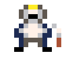 | 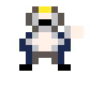 |
| **Arcanist** | Ranged Caster | Spark & Arcane Barrage | 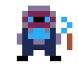 | 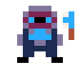 |
| **Shadow** | Agility / Assassin | Shadow Strike & Dagger Flurry | 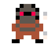 | 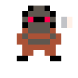 |
| **Paladin** | Sacred Guardian (32×32) | Radiant Aura | 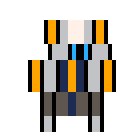 | — |

---

#### 💀 Monsters, Bosses & Crypt Objects
From scurrying cave crawlers to towering bosses and dungeon interactables:
<div align="center">
  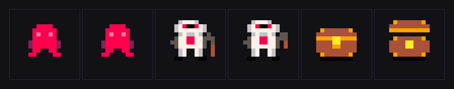
</div>

| Entity | Type | Behavior | Sprite Preview |
| :--- | :--- | :--- | :---: |
| **Crawler** | 12×12 Vermin | Swarming melee pack predator |   |
| **Brute** | 12×12 Heavy Elite | High HP cleaving tank | 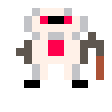 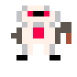 |
| **Overlord** | 32×64 Dungeon Boss | Multi-phase dungeon master | 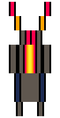 |
| **Crypt Chest** | 12×12 Loot Container | Procedural affix gear drops | 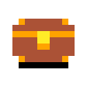 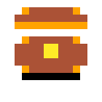 |
| **Arcane Shrine**| 12×12 Buff Altar | Temporary stat empowerments | 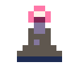 |
| **Stairs Down** | 12×12 Descent Tile | Floor progression portal |  |

---

#### ⚔️ Equipment, HUD & Paperdoll Grid
Over 50 bit-sprites powering weapons, armor, shields, rings, potions, and character sheet attributes:
<div align="center">
  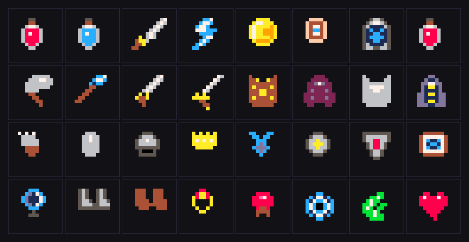
</div>

<div align="center">

| Health Potion | Mana Potion | Longsword | Wand | Cleaver | Cuirass | Kite Shield | Crown | Signet | Portal |
| :---: | :---: | :---: | :---: | :---: | :---: | :---: | :---: | :---: | :---: |
| 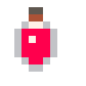 | 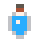 | 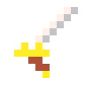 | 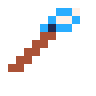 | 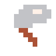 |  | 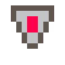 |  | 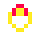 | 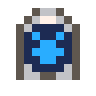 |

| Might | Focus | Agility | Vitality | Coin | Scroll | Spark | Boots | Floor Tile | Wall Tile |
| :---: | :---: | :---: | :---: | :---: | :---: | :---: | :---: | :---: | :---: |
| 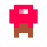 |  | 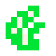 |  |  | 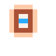 | 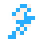 |  |  | 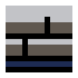 |

</div>

---

#### 🏰 Procedural Dungeon Tile Palette
Environment building blocks for dungeon floors, stone walls, and underground corridors:
<div align="center">
  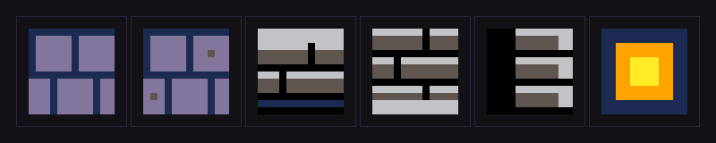
</div>

---

## 🏛️ System Architecture

```text
Sanctum/
├── shared/                     # Deterministic core shared by Node.js server & browser client
│   ├── Constants.js            # Engine specs, 16-color PALETTE, tiles, rarities, packet types
│   ├── MathUtils.js            # 32-bit deterministic PRNG (Mulberry32), distance, clamping
│   ├── DungeonGen.js           # Seeded 40×30 procedural dungeon generator with BFS connectivity
│   └── CombatMath.js           # Damage rolls, primary stat scaling, armor mitigation, NG+ scaling
├── server/                     # Node.js authoritative server & persistence layer
│   ├── server.js               # REST API, static asset router, WebSocket lobby manager
│   └── systems/
│       ├── GameRoom.js         # 15 Hz tick loop: AI, combat, loot, floor progression
│       ├── DataRegistry.js     # Schema validation and JSON content table loader
│       ├── LootGenerator.js    # Procedural affix rolls (Normal, Magic, Rare, Unique)
│       ├── Database.js         # SQLite with WAL mode & scrypt authentication
│       ├── AuthService.js      # Session token lifecycle & anti-enumeration
│       └── SaveManager.js      # Character state persistence & Hall of Fallen Heroes
├── client/                     # Zero-dependency browser client
│   ├── index.html              # Viewport canvas, HUD overlays, Auth/Lobby browser
│   ├── app.js                  # Coordinator: WebSocket lifecycle, input routing, rAF loop
│   ├── dev.html / dev.js       # In-browser Sprite Digitizer & Lanthorn-PSG Sound Lab (/dev)
│   ├── mod.html / mod.js       # In-game Moderator Portal (/mod)
│   └── systems/
│       ├── LightingSystem.js   # 2D merged-wall analytical lighting & 9-band Bayer dithering
│       ├── Renderer.js         # Dual-canvas retro pipeline & subpixel entity stamping
│       ├── CanvasHUD.js        # Canvas Life/Mana glass globes with wave meniscus & belt bar
│       ├── BitSprites.js       # Fast bit-array sprite decoder & IndexedDB caching
│       ├── Interpolator.js     # 15 Hz snapshot buffer -> 60+ FPS client interpolation
│       └── AudioPSG.js         # Lanthorn-PSG dual-oscillator synthesizer & dynamic tracker
└── data/                       # Content tables, sound patches, tracker CSVs & SQLite storage
```

---

## 🚀 Getting Started

### Prerequisites
* **Node.js**: v18.0.0 or higher
* **npm**: v9.0.0 or higher

### Installation & Launch

1. **Clone the repository:**
   ```bash
   git clone https://github.com/Edwigeon/Sanctum.git
   cd Sanctum
   ```

2. **Install server dependencies:**
   ```bash
   npm install
   ```

3. **Start the authoritative game server:**
   ```bash
   npm start
   ```

4. **Play in your browser:**
   Open [http://localhost:3000](http://localhost:3000) in any modern browser.

---

## 🛠️ Developer Scripts & Tools

| Command | Description |
| :--- | :--- |
| `npm start` | Launches the server at `http://localhost:3000` (or configured `PORT`). |
| `npm test` | Runs the full verification suite (technical plan + security hardening checks). |
| `npm run sprites:extract` | Parses bit arrays from `sprites.json` & `BitSpriteCatalog.js` into crisp scaled PNGs and showcase banners in `assets/sprites/`. |
| `npm run pack:music` | Compiles raw Lanthorn-PSG CSV tracker projects into a packed JSON soundtrack bundle. |
| `npm run backup` | Creates an atomic backup of the SQLite database. |

### Built-in In-Browser Studios
* **/dev Studio (`http://localhost:3000/dev.html`)**: Interactive sprite digitizer, 16-color palette mapper, frame animator, and live torchlight preview.
* **/mod Portal (`http://localhost:3000/mod.html`)**: Real-time room inspection, moderator commands, and telemetry monitor.

---

## 📜 License

Project Sanctum is open source under the [MIT License](LICENSE).
